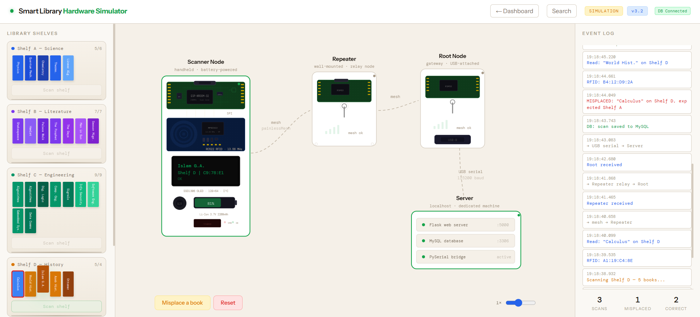
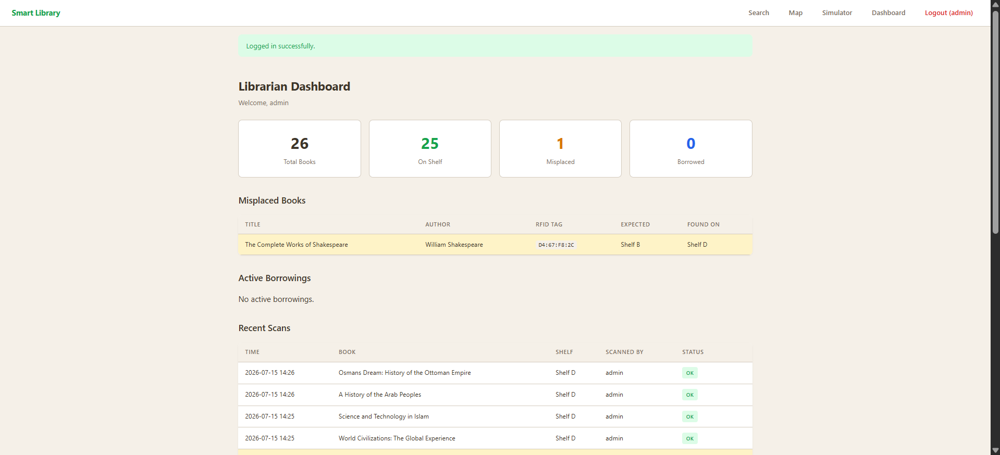
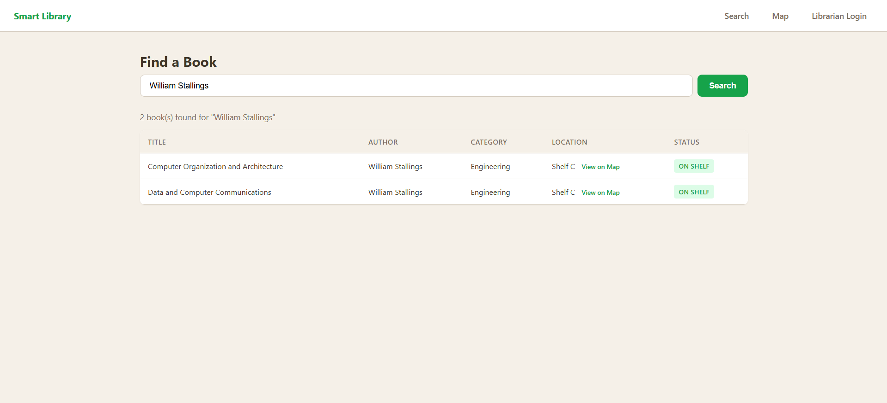

# Graduation Project (Smart Library)

A graduation project completed at Yarmouk University. The application supports book search, borrowing and returns, misplaced-book tracking, a library map, and simulated RFID shelf scans.

## Features

- Search books by title, author, or RFID tag.
- View book locations and misplaced books on an interactive shelf map.
- Manage borrowing and returns through the librarian dashboard.
- Simulate shelf scans, misplaced books, and scan logging.

## Technology

Python, Flask, MySQL, HTML, CSS, JavaScript, and SVG. The simulator illustrates the proposed scanner/repeater/root-node flow; this repository does not contain physical-device firmware or a serial bridge implementation.

## Screenshots






## Simulator files

- `Smart_Library_Simulator_V3.2.html`: standalone simulator page; open it in a browser.
- `smart_library/templates/simulator.html`: simulator integrated with the Flask application.
- `smart_library/routes/scanner.py`: server routes used by the integrated simulator.

## Run locally

Requires Python and a running MySQL server. From the project folder:

```powershell
python -m venv .venv
.\.venv\Scripts\Activate.ps1
python -m pip install -r smart_library/requirements.txt
```

Import `Graduation Project Database.sql` with your MySQL client. **The script deletes and recreates the database named `smart_library`. Only import it into a disposable demo database.** The sample students in this file are fictional.

Set these variables in the same PowerShell window used to run the app. The database password prompt hides what you type; values are not written to project files.

```powershell
$env:DB_HOST = 'localhost'
$env:DB_PORT = '3306'
$env:DB_USER = 'root'
$env:DB_NAME = 'smart_library'
$privateDbPassword = Read-Host 'MySQL password' -AsSecureString
$env:DB_PASSWORD = [System.Net.NetworkCredential]::new('', $privateDbPassword).Password
$env:SECRET_KEY = python -c "import secrets; print(secrets.token_hex(32))"
python smart_library/setup_passwords.py
python smart_library/app.py
```

The account setup asks you to choose and confirm passwords for `admin` and `librarian1`. Open http://127.0.0.1:5000 in your browser. Visit `/simulator` for the integrated simulator. Keep the session key stable while running the app; generating a new key invalidates prior sessions.

Changing these source files does not update an existing database. Reimporting sample data destroys existing data as described above; the password setup script updates the application accounts only, not the MySQL account.

## Prototype limitations

This is an academic prototype with simulated scans. Database-changing simulator endpoints currently do not require authentication, and the app uses Flask development/debug mode. Run it locally; further security work is required before hosting a public live service.


